<a href="https://yexofps.org/en"></a>

<a href="https://yexofps.org/en"></a>
<a href="https://discord.gg/tjAkrNUFAR"></a>
<a href="https://yexofps.org/en/contact"></a>

<a href="https://yexofps.org/en/career"></a>

 

<a href="https://yexofps.org/en/projects">
  <picture>
    <source media="(prefers-color-scheme: dark)" srcset="assets/projects-dark.svg">
    
  </picture>
</a>

<a href="https://yexofps.org/en/projects/yexofx"></a>
<a href="https://github.com/Yexo0/Claimd"></a>
<a href="https://yexofps.org/en/projects/yexoclip"></a>
<a href="https://yexofps.org/en"></a>

 


 

<a href="https://yexofps.org/en"></a>
